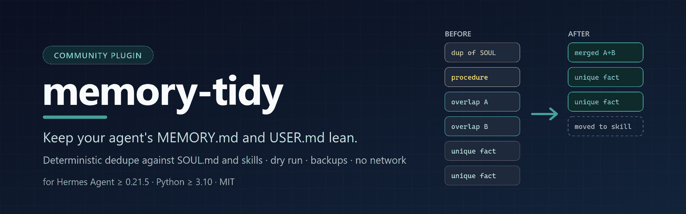

<p align="center">
  
</p>

<h1 align="center">memory-tidy</h1>

<p align="center">
  <b>Find what your Hermes Agent memory repeats, and tidy it up without losing a single fact.</b>
</p>

<p align="center">
  <a href="LICENSE"></a>
  <a href="pyproject.toml">= 3.10"></a>
  <a href="https://hermes-agent.nousresearch.com/docs">= 0.21.5"></a>
  <a href="#development"></a>
  
</p>

<p align="center">
  <a href="#quick-start">Quick start</a> ·
  <a href="#example-output">Example</a> ·
  <a href="#case-study-the-authors-own-hermes">Case study</a> ·
  <a href="#how-it-works">How it works</a> ·
  <a href="#safety-model">Safety</a> ·
  <a href="#configuration">Configuration</a> ·
  <a href="#known-limitations">Limitations</a> ·
  <a href="#faq">FAQ</a> ·
  <a href="CONTRIBUTING.md">Contributing</a>
</p>

> **Community plugin.** memory-tidy is an independent plugin for
> [Hermes Agent](https://github.com/NousResearch/hermes-agent). It is not made, endorsed or
> supported by Nous Research.

Hermes puts three texts into every session: `SOUL.md` (written by you), and `memories/MEMORY.md`
and `memories/USER.md` (written by the agent, each with a hard character budget). Over time the two
memory files fill up with facts `SOUL.md` already states, procedures that belong in a skill,
entries that say the same thing twice, and facts that went stale. memory-tidy finds them with
**deterministic text similarity** (no network, no LLM) and applies a plan you have reviewed, with a
dry run, backups, the memory tool's own file lock and atomic writes.

<table>
<tr><td><b>Read-only scan</b></td><td>Usage % per memory file and, per entry, a verdict (<code>duplicate_of_soul</code>, <code>duplicate_of_skill</code>, <code>overlaps_entry</code>, <code>procedure_like</code>, <code>ok</code>), evidence with <code>file:line</code>, a suggested action, and hints for partial duplicates and possibly stale facts.</td></tr>
<tr><td><b>Reviewed tidy plans</b></td><td><code>remove</code>, <code>replace</code>, <code>add</code> and <code>append_skill</code> actions. Dry run by default: the diff comes first, the write second.</td></tr>
<tr><td><b>No silent fact loss</b></td><td>A removal is refused if the old text holds a path, URL, ID, number, version, code span or sentence that would no longer exist anywhere.</td></tr>
<tr><td><b>Budget-aware</b></td><td>Same character budget and counting rule as the Hermes memory tool. A file that is already over budget may shrink, never grow.</td></tr>
<tr><td><b>Gentle reminder</b></td><td>At most once per <code>check_interval_hours</code>, the first turn of a new session gets a one-line hint when a file is over <code>usage_threshold</code> % or exact <code>SOUL.md</code> duplicates exist.</td></tr>
<tr><td><b>Zero dependencies</b></td><td>Standard-library Python. No network calls, no LLM calls, no credentials, no shell commands, no background processes.</td></tr>
</table>

## Quick start

```bash
hermes plugins install Santrionlinecom/hermes-memory-tidy
hermes plugins enable memory-tidy
```

Or clone it yourself:

```bash
git clone https://github.com/Santrionlinecom/hermes-memory-tidy ~/.hermes/plugins/memory-tidy
```

A gateway that is already running picks the plugin up on its next restart (or when Hermes reloads
plugins). Requires Hermes Agent >= 0.21.5 and Python >= 3.10.

Then, in any chat:

```text
/memory-tidy
```

## Example output

This is a real run against the **synthetic** profile that
[`examples/make_demo_home.py`](examples/make_demo_home.py) creates (an invented "Acme Docs"
assistant: one `SOUL.md`, five `MEMORY.md` entries, one `USER.md` entry, one skill). No real memory is involved, and a test
(`tests/test_example.py`) keeps this output honest. Try it yourself from the repo root:

```bash
python examples/make_demo_home.py /tmp/demo-home
python -m memory_tidy.cli --home /tmp/demo-home scan
```

Output:

```text
memory-tidy scan (read-only)
  memories/MEMORY.md: 473/1000 chars (47.3%), 5 entries
  memories/USER.md: 75/800 chars (9.4%), 1 entries
  compared with SOUL.md and 1 skill files
Verdicts: duplicate_of_soul=1, duplicate_of_skill=0, overlaps_entry=2, procedure_like=1, ok=2
  memory#0 [3bb92504c2] duplicate_of_soul (1.0) -> remove
  memory#1 [5d41baea10] procedure_like (6.0) -> move_to_skill:skills/devops/docs-release/SKILL.md
  memory#2 [5c90758763] overlaps_entry -> merge_with:3
  memory#3 [7d0019b7dd] overlaps_entry -> merge_with:2
1 near-exact SOUL.md duplicate(s): /memory-tidy apply-exact removes them (backup kept).
Ask the agent to review the scan and prepare a memory_tidy_apply plan (dry run first).
```

`scan --json` adds the evidence behind every verdict, for example (excerpt):

```json
{
  "index": 0,
  "id": "3bb92504c2",
  "verdict": "duplicate_of_soul",
  "suggested_action": "remove",
  "evidence": [
    {
      "entry_text": "Never publish or deploy anything without explicit approval from the owner.",
      "matched": "Never publish or deploy anything without explicit approval from the owner.",
      "where": "SOUL.md:5",
      "containment": 1.0,
      "source": "soul"
    }
  ]
}
```

`apply-exact` without `--write` only previews the change and writes nothing: the report says
`"status": "dry_run"` and `"removed": 0`, and shows that MEMORY.md would go from 473 to 396 chars
(5 to 4 entries).

## Case study: the author's own Hermes

memory-tidy was built for, and is used on, the Hermes profile that runs
[SantriOnline](https://santrionline.com), a one-person Islamic education business in Batu, Indonesia.
That Hermes works around the clock as a Telegram assistant, coder and content producer, so its
memory fills up fast. The numbers below come from a read-only scan of that profile (no entry text is
published here; the memory holds private notes).

**The profile**

| | |
|---|---|
| `MEMORY.md` | 5,985 / 6,000 chars (99.8%), 25 entries |
| `USER.md` | 5,297 / 6,000 chars (88.3%), 23 entries |
| `SOUL.md` | 16.5 KB, written by the owner |
| Skills | 328 skills, 2,193 `.md` files indexed |
| Memory language | mostly Indonesian |

**What happened**

1. **Memory hit the wall.** `MEMORY.md` sat at 99.8%. Hermes' context compression drops the middle of
   long memory, so new lessons were either refused or squeezed in by shortening older ones by hand.
2. **The first scan (0.1.0) gave bad advice.** Entries that read like procedures were told to move into
   skills that had nothing to do with them, for example a note about a GPU cloud account pointed at an
   ECG-simulator skill, because the target was chosen by word overlap with the skill body. With 300+
   skills, some huge, there is always a body that shares enough words.
   That became [#1](https://github.com/Santrionlinecom/hermes-memory-tidy/issues/1).
3. **0.1.1 fixed it with a topic check.** A skill must now name the entry's topic in its folder name,
   `name` or `description`, and beat the runner-up by 15%; words shared by most of the profile's own
   entries (owner name, year) no longer count as topic. A regression test reproduces the failure with
   60 decoy skills. On the real profile, a note about handling API keys now points at the
   credential-handling skill instead of a Q&A-bank skill.
4. **0.1.2 hardened the write path** after the plugin-catalog review
   ([NousResearch/hermes-agent#159817](https://github.com/NousResearch/hermes-agent/pull/159817)): the
   model tool honours `write_approval` and never commits model-written text (see
   [Safety model](#safety-model)).

**What the current scan reports on that profile**

- **0 duplicates of SOUL.md or of a skill, 0 overlapping entries.** The owner already moves rules into
  `SOUL.md` and procedures into skills, so the memory is mostly unique facts. memory-tidy confirms
  that with evidence instead of guessing, which is also a result.
- **3 procedure-like entries (938 chars, about 8% of both files)** that belong in a skill:
  - a client-operations note -> the client-operations skill (correct);
  - a credential-intake note -> the credential-handling skill (correct);
  - a browser-profile note -> a social-media API skill (questionable: the note mentions social media
    in passing, see [Known limitations](#known-limitations)).
- **Speed:** full scan against all 2,193 skill files in about 12 s on a laptop CPU; the SOUL-only check
  that runs at session start takes about 0.3 s.

**Takeaways**

- On a busy profile the win is not deleting a lot, it is knowing *which* entries can move and proving
  that nothing unique is lost (the unique-fact check refuses a removal that would drop a literal).
- Suggestions are hints. Two of three were right; the dry run is where a human catches the third.
- Non-English memory works, with noisier scores (stopwords are English only).

## Usage

| Surface | What it does |
|---|---|
| `memory_tidy_scan` tool | Read-only JSON report: usage %, verdicts, evidence, suggested actions (`remove`, `merge_with:<idx>`, `move_to_skill:<path>`, `keep`) and hints. |
| `memory_tidy_apply` tool | Dry-runs a plan of `remove`, `replace`, `add` and `append_skill` actions. A real run from the model commits `remove` only, and only while `memory.write_approval` is off; anything else is saved as a plan file for the user's CLI. |
| `/memory-tidy` | Scan summary in chat (read-only). |
| `/memory-tidy preview-exact` | Shows the entries that are near-exact copies of `SOUL.md`, without writing. |
| `/memory-tidy apply-exact` | Removes only those entries (backup kept). |
| Session-start check | `pre_llm_call` hook, first turn of a new top-level session only, rate-limited. |
| `hermes memory-tidy` CLI | `scan [--json] [--out FILE] [--no-skills]`, `apply PLAN.json [--write]`, `apply-exact [--write]`. |

A typical round:

1. Run `/memory-tidy` (or ask the agent to call `memory_tidy_scan`).
2. Review the flagged entries. For a procedure, first move its unique details into the suggested
   skill, then remove the entry, in one plan:

   ```json
   [
     {"action": "append_skill", "path": "skills/devops/docs-release/SKILL.md",
      "text": "## Release steps\n\n1. npm run build\n2. wrangler pages deploy dist"},
     {"action": "remove", "target": "memory", "id": "5d41baea10", "expect": "To release the docs site"}
   ]
   ```

3. Call `memory_tidy_apply` with the plan (dry run) and read the diff.
4. Commit it. A remove-only plan can be committed by the tool with `"dry_run": false` (unless
   `memory.write_approval` is on). This plan writes model-authored text (`append_skill`), so the
   tool answers `"status": "needs_user"`, saves the plan under `$HERMES_HOME/memory-tidy/plans/` and
   returns the command for you to run yourself:

   ```bash
   hermes memory-tidy apply ~/.hermes/memory-tidy/plans/<file>.json          # dry run
   hermes memory-tidy apply ~/.hermes/memory-tidy/plans/<file>.json --write  # really write
   ```

| Action | Fields |
|---|---|
| `remove` | `target` (`memory`/`user`), `index` or `id`, optional `expect` (prefix guard) |
| `replace` | `target`, `index` or `id`, `text` (use it to merge overlapping entries) |
| `add` | `target`, `text` |
| `append_skill` | `path` (a `.md` file inside `skills/`), `text` |

Indexes and ids come from the scan report and refer to the files as they are when the plan runs; if
a file changed since the scan, the plan is refused and you re-scan.

## How it works

```text
 SOUL.md ─────────┐
 skills/**/*.md ──┼─► tokenise + index ──► per-entry scores ──► verdict + evidence
 MEMORY.md ───────┤   (NFKC, stopwords,    (coverage, near-exact,         │
 USER.md ─────────┘    3-token shingles)    literals, procedure)          ▼
                                                                     scan report (read-only)
                                                                          │
                                                                          ▼
              backup + lock + atomic write ◄── safety checks ◄── your reviewed plan (dry run first)
```

- Text is NFKC-normalised, lower-cased and split into word tokens without stopwords.
- Each entry sentence is matched against the best source sentence (plus its neighbour) through an
  inverted index; **coverage** is the token-weighted containment of the entry in the source.
- **Near-exact** is the share of the entry's 3-token shingles found in `SOUL.md`, capped by the share
  of its literals found there.
- An entry is a duplicate when coverage >= 0.8 and every literal is present (or near-exact >= the
  threshold). Overlaps use token containment / shingle overlap between entries.
- Procedure-likeness scores numbered steps, command lines, CLI flags, paths, URLs, IDs, versions,
  imperative sentences and env variables.
- **`move_to_skill` target**: a skill is suggested only when its folder name, `name` or `description`
  contains at least two of the entry's words that few other skills use, it shares at least three
  words with the entry, and it clearly beats the runner-up (15% margin). Words most of your own
  entries share (your name, the year) don't count as topic. Otherwise the action is
  `move_to_skill:<new skill>`. Either way `evidence[0].skill_candidates` lists the top three skills
  with score, shared word count and the head words that matched, so you can judge.
- Stale hints flag dates more than 120 days old and temporary wording ("currently", "for now",
  "until ..."). They are hints only.
- The first scan of a large skills tree takes a few seconds; later scans in the same process reuse
  the index until a file changes.

Code layout: [`textsim.py`](memory_tidy/textsim.py) (tokens, literals, similarity),
[`scanner.py`](memory_tidy/scanner.py) (verdicts), [`applier.py`](memory_tidy/applier.py) (plan
checks and writes), [`store.py`](memory_tidy/store.py) (file format, lock, atomic replace),
[`service.py`](memory_tidy/service.py) (tools, slash command, hook), [`cli.py`](memory_tidy/cli.py).

## Safety model

- **SOUL.md is never written.** Only `memories/MEMORY.md`, `memories/USER.md` and `.md` files inside
  `skills/` can change. Paths outside `skills/`, `..` tricks, absolute paths elsewhere and symlinks
  that escape are refused. `append_skill` only appends, and only inside an existing skill folder
  (or its `references/`).
- **No silent fact loss.** A `remove` or `replace` is refused when the old text holds a literal
  (path, URL, ID, number, version, code span) or a sentence that is not present in `SOUL.md`, the
  skills or the remaining entries after the plan. Override with `force_unique_loss: true`.
- **Budget.** Each memory file must end within the budget Hermes enforces
  (`memory.memory_char_limit` / `memory.user_char_limit`, same counting rule as the memory tool).
  A file that is already over budget may shrink but never grow.
- **Dry run by default.** Nothing is written unless `dry_run` is `false`.
- **The model never commits its own text.** `add`, `replace` and `append_skill` write text that the
  model wrote into files that load into future prompts. Hermes screens such text in its own `memory`
  and `skill_manage` tools; this plugin does not duplicate that screening, so from the
  `memory_tidy_apply` tool those actions are dry-run only. The user applies them with
  `hermes memory-tidy apply <plan> --write` after reading the diff.
- **`write_approval` is honoured.** With `memory.write_approval: true` (or `skills.write_approval:
  true` for skill files) the tool writes nothing at all, not even a `remove`: it returns the diff and
  a saved plan for the user. The periodic `auto_apply_exact` is skipped too. The setting is read the
  way Hermes reads it, and a `config.yaml` that cannot be parsed counts as on (fails closed).
- **Backups.** A real run copies every file it changes to
  `$HERMES_HOME/memory-tidy/backups/<timestamp>/` with a `manifest.json` holding the plan.
- **Concurrency.** Reads and writes happen under the memory tool's own lock files
  (`MEMORY.md.lock`, `USER.md.lock`); files are replaced atomically (temp file + rename).
- **The only automatic deletion** is `apply-exact`: entries whose near-exact similarity to `SOUL.md`
  is at least `exact_threshold` (never below 0.8) and whose literals all appear in `SOUL.md`. The
  periodic check only does this when `auto_apply_exact: true`.
- **Local only.** No network calls, no LLM calls, no credentials, no shell commands and no background
  processes. Chat output carries no host paths.

### Disclosure

Reads `SOUL.md`, `memories/MEMORY.md`, `memories/USER.md` and the `SKILL.md` files under `skills/`.
Writes memory files and skill `.md` files only when a plan is committed: by the tool for remove-only
plans while `memory.write_approval` is off, otherwise by the user's `hermes memory-tidy apply --write`
(backups under `$HERMES_HOME/memory-tidy/`). Plans the tool may not commit are saved under
`$HERMES_HOME/memory-tidy/plans/`. Also writes the periodic check's timestamp in
`$HERMES_HOME/memory-tidy/state.json` (and, only if you set `auto_apply_exact: true`, near-exact
`SOUL.md` duplicates removed with a backup). One `pre_llm_call` hook adds a short suggestion to the
first turn of a new session when a memory file is near its budget.

Found a security problem? Please report it privately, see [SECURITY.md](SECURITY.md).

## Configuration

`config.yaml` → `plugins.entries.memory-tidy.settings`:

| Key | Default | Meaning |
|---|---|---|
| `enabled` | `true` | Run the session-start check. |
| `usage_threshold` | `85` | Percent of a file's budget that triggers the suggestion. |
| `exact_threshold` | `0.92` | Near-exact similarity for `apply-exact` (clamped to 0.8-1.0). |
| `check_interval_hours` | `24` | Minimum hours between checks. |
| `auto_apply_exact` | `false` | Let the check remove near-exact `SOUL.md` duplicates itself. |

## Known limitations

- **`move_to_skill` is still a hint.** Since 0.1.1 a target must name the entry's topic in its
  `name`/`description` ([#1](https://github.com/Santrionlinecom/hermes-memory-tidy/issues/1)), which
  stops suggestions such as a GPU-cloud note going to an ECG-simulator skill. Matching is still by
  words, so a skill can win on two topic words the entry mentions in passing, and a good home whose
  description uses other words is missed. Check `skill_candidates` and the target before writing
  `append_skill`; the dry run shows the diff.
- **English stopwords only.** Memory written in other languages still works, but scores are noisier
  because function words are not filtered out.
- **Lexical, not semantic.** Two entries that say the same thing in different words are not
  detected as overlapping. That is the price of having no LLM and no network.
- **Stale hints are heuristics** (old dates, temporary wording); they are never acted on
  automatically.

## FAQ

**Does it send my memory anywhere?**
No. Everything runs locally inside the Hermes process; the code makes no network or LLM calls.

**Can it delete something important?**
Only through a remove-only plan (blocked while `memory.write_approval` is on), a plan you apply
yourself with `hermes memory-tidy apply --write`, or `apply-exact` for entries that are
near-exact copies of `SOUL.md`. Removals that would lose a unique literal or sentence are refused,
and every real run makes a backup first.

**How do I undo a change?**
Copy the files back from `$HERMES_HOME/memory-tidy/backups/<timestamp>/`; `manifest.json` lists the
plan that changed them.

**Why not just ask the agent to clean its memory?**
The agent still reviews the scan and writes the plan. memory-tidy gives it evidence (`file:line`
matches, scores) and a guarded writer, so the result does not depend on how careful the model
happens to be that day.

**Does it touch `SOUL.md`?**
Never. It is only read, as the reference text.

## Development

```bash
python -m pytest            # from the repo root; needs pytest only
python -m memory_tidy.cli --home /path/to/hermes-home scan
```

Tests build a temporary `HERMES_HOME` with fake files; they never read a real profile. The tests
badge is a static badge for the last local run; there is no hosted CI yet.

## Contributing

Bug reports, ideas and pull requests are welcome. Please read [CONTRIBUTING.md](CONTRIBUTING.md)
and the [Code of Conduct](CODE_OF_CONDUCT.md) first. Never paste real memory contents into an issue:
build a small synthetic example instead (see `examples/make_demo_home.py`).

## License

MIT - see [LICENSE](LICENSE). Hermes Agent is a project of Nous Research; this plugin is an
independent community project and uses the name only to say what it works with.
